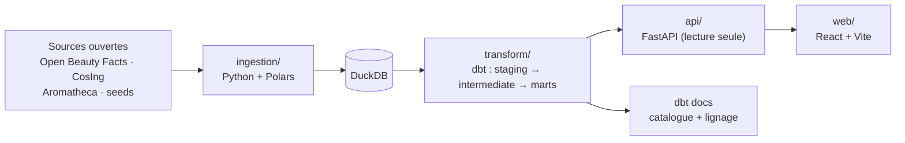

# Dupe Finder

> 🚧 **En construction** : phase 0 (socle) en cours. Voir la [roadmap](docs/ROADMAP.md).

**Trouver l'alternative la plus proche d'un soin visage ou d'un parfum, et comprendre pourquoi.**

Deux produits aux formules quasi identiques peuvent varier de 1 à 5 en prix. Dupe Finder compare les soins sur leur composition INCI et les parfums sur leur pyramide olfactive, puis affiche un **score de similarité transparent** : actifs communs, ingrédients différents, poids de chaque position dans la liste.

C'est aussi une vitrine **Analytics Engineering / Data Governance** : pipeline de bout en bout, modélisation dbt, référentiel maître des ingrédients, règles de qualité testées, lignage et documentation publiés.

*Démo, lien vers l'app et indicateurs de qualité : à venir (phase 6).*

## Architecture



Les similarités sont **précalculées par dbt** ; l'API ne fait que lire. Détails : [docs/ARCHITECTURE.md](docs/ARCHITECTURE.md).

| Dossier | Rôle |
| --- | --- |
| [`docs/`](docs/) | PRD, architecture, modèle de données, scoring, roadmap, ADR |
| [`ingestion/`](ingestion/) | Téléchargement et chargement des sources |
| [`transform/`](transform/) | Projet dbt (dbt-duckdb) |
| [`scoring/`](scoring/) | Implémentation Python de référence du score |
| [`api/`](api/) | API FastAPI |
| [`web/`](web/) | Front React |
| [`notebooks/`](notebooks/) | Exploration uniquement |
| [`tests/`](tests/) | Tests pytest |
| [`data/`](data/) | Fichiers DuckDB et exports (non versionnés) |

## Installation

Prérequis : [uv](https://docs.astral.sh/uv/), GNU make, git. Sous Windows, utiliser Git Bash (`winget install ezwinports.make` pour make).

```bash
git clone <url-du-dépôt> dupe-finder
cd dupe-finder
cp .env.example .env
make setup   # Python 3.12 + dépendances verrouillées, hooks pre-commit, packages dbt
make check   # lint + tests + dbt debug
```

`make help` liste toutes les commandes.

## Licences

- **Code** : [MIT](LICENSE).
- **Données** : la base est dérivée d'[Open Beauty Facts](https://world.openbeautyfacts.org/), publiée sous [Open Database License (ODbL)](https://opendatacommons.org/licenses/odbl/1-0/), contenus sous [Database Contents License](https://opendatacommons.org/licenses/dbcl/1-0/). Les données propres au projet (seeds : actifs, synonymes, notes de parfums, liens, paires de test) et toute base enrichie publiée sont également sous **ODbL**.
- Autres sources : CosIng (Commission européenne, données publiques), Aromatheca (CC BY 4.0). Détails dans [docs/PRD.md](docs/PRD.md#4-sources-de-données-et-licences).

*Données : Open Beauty Facts, licence ODbL.*

## Avertissement

Une composition proche ne garantit ni la même concentration, ni la même texture, ni la même tolérance cutanée. Dupe Finder ne donne aucun avis dermatologique. Les noms de marques servent uniquement à identifier les produits.
