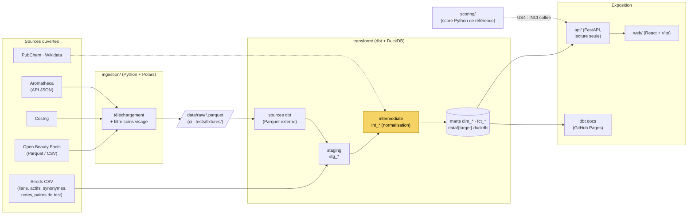

# Architecture — Dupe Finder

> Source : sections 5, 9, 10, 11 et 12 de [DOSSIER_CONCEPTION.md](DOSSIER_CONCEPTION.md).

## 1. Vue d'ensemble

Les données circulent dans un seul sens : sources ouvertes, ingestion Python, transformations dbt dans DuckDB, puis une API en lecture seule et le front.

La couche intermediate, en couleur, porte la normalisation des ingrédients : c'est là que se joue la qualité du score.

**Frontière Python / dbt : le fichier Parquet.** L'ingestion Python télécharge et filtre les sources, puis écrit du Parquet dans `data/raw/`. Elle n'écrit rien dans DuckDB. dbt déclare ces fichiers comme sources (lecture de Parquet externe par dbt-duckdb) et matérialise les modèles dans le fichier DuckDB de la cible (`data/dev.duckdb`, `data/ci.duckdb`, `data/prod.duckdb`). En CI, les sources pointent vers un Parquet figé de 200 produits dans `tests/fixtures/`, par le même chemin de chargement. Les seeds dbt sont réservés aux référentiels saisis à la main.

Le contenu de `data/` est ignoré par git (seuls `data/.gitkeep` et `data/README.md` sont versionnés).

## 2. Stack technique

La stack reste gratuite, locale d'abord, et alignée sur les offres Analytics Engineer : Python, DuckDB, dbt, puis une API et un front légers.

| Brique | Choix | Pourquoi | Alternative |
| --- | --- | --- | --- |
| Langage | Python 3.12, géré avec uv | Standard data, rapide à installer | Poetry |
| Ingestion | Scripts Python + Polars | Lecture directe du Parquet OBF, performant | pandas |
| Entrepôt | DuckDB (fichier local) | Gratuit, zéro serveur, SQL analytique complet | Snowflake (essai gratuit) pour une variante « CV » |
| Transformation | dbt-core + dbt-duckdb, dbt_utils, dbt_expectations | Tests, docs et lignage natifs | SQLMesh |
| Orchestration | Makefile en local, GitHub Actions planifié (mensuel) | Suffisant pour un rafraîchissement mensuel | Dagster en V2 |
| API | FastAPI + Pydantic | Typage, doc OpenAPI auto, simple | Flask |
| Front | React + Vite + TypeScript + Tailwind | Rapide, léger, montre une app « produit » | Streamlit (plus rapide, moins pro) |
| Qualité du code | ruff, mypy, sqlfluff, pre-commit | Lint Python et SQL automatique | black + flake8 |
| Tests | pytest, tests dbt, Vitest côté front | Couvre chaque couche | — |

**Décision structurante.** Les similarités sont précalculées par dbt, pas à la volée. L'API se contente de lire `fct_product_similarity`. Seule la comparaison d'une liste INCI collée (US4) se calcule à la demande, avec la même fonction Python que les tests.

**Briques IA (module de rapprochement assisté, voir [DATA_MODEL.md](DATA_MODEL.md#module-de-rapprochement-assisté)).** `sentence-transformers` pour les embeddings, extension `vss` de DuckDB pour la recherche vectorielle, Ollama pour le LLM local, et les API PubChem et Wikidata en amont. Option payante : API Mistral ou Claude. Dans la variante Snowflake, Cortex permet d'appeler embeddings et LLM directement en SQL, depuis un modèle dbt.

## 3. API et interface web

L'API expose cinq routes en lecture seule. L'interface tient en quatre pages.

| Méthode | Route | Rôle | Réponse principale |
| --- | --- | --- | --- |
| GET | `/products/search?q=` | Autocomplétion nom ou marque, filtrable par univers (soins ou parfums) | 10 produits max : id, nom, marque |
| GET | `/products/{id}` | Fiche produit | INCI ou notes normalisés, liens, score qualité |
| GET | `/products/{id}/dupes?limit=5` | Produits proches | Liste triée : score, composantes J/A/F, ingrédients communs |
| POST | `/compare/inci` | Comparer une liste INCI collée (soins uniquement) | Tokens reconnus ou non + top 5 |
| GET | `/meta/quality` | Indicateurs de qualité | Dernière valeur et historique par règle |

**Pages.**

1. Accueil : choix de l'univers (soins ou parfums), barre de recherche, zone « coller une liste INCI » côté soins, une phrase sur la méthode.
2. Résultats : cartes des 5 dupes, lien vers chaque produit, badge de fiabilité.
3. Comparaison : deux colonnes INCI et jauges J/A/F pour un soin ; deux pyramides olfactives côte à côte pour un parfum, notes communes surlignées.
4. Méthode et qualité : explication du score, indicateurs, lien vers la doc dbt et le dépôt GitHub.

**Exigences non fonctionnelles.** Réponse API < 300 ms au 95e centile. Interface utilisable sur mobile. Accessibilité de base (contrastes, navigation clavier). Interface en français, code et commentaires en anglais.

## 4. Stratégie de tests

Chaque couche a ses tests, et la CI bloque toute fusion si l'un d'eux échoue.

| Niveau | Outil | Ce qu'on vérifie | Exemple |
| --- | --- | --- | --- |
| Unitaire Python | pytest | Nettoyage, découpage INCI, calcul du score | « Aqua/Water (Eau) » → un seul token `aqua` |
| Données (schéma) | tests dbt génériques | Clés uniques et non nulles, relations | `product_id` unique dans `dim_product` |
| Données (métier) | dbt_expectations + tests singuliers | Seuils de qualité ([DATA_MODEL.md](DATA_MODEL.md)) | Taux de reconnaissance ≥ 90 % |
| Tests unitaires dbt | `unit_tests` dbt | Logique SQL sur jeux de données figés | Deux produits identiques → score 100 |
| Parité SQL / Python | pytest | Le score SQL (batch) et le score Python (à la demande) donnent le même résultat | Écart < 0,01 sur 50 paires fixes |
| Qualité du résultat | modèle dbt d'évaluation | Rappel@5 sur les paires de référence | ≥ 75 % |
| API | pytest + httpx | Codes retour, schémas de réponse | 404 sur un produit inconnu |
| Front | Vitest + Testing Library | Rendu des composants clés | Carte résultat affiche le score |

**Règle de travail.** Tout bug corrigé ajoute d'abord un test qui le reproduit.

## 5. Déploiement, CI/CD et coûts

Cible : 0 € par mois. Le fichier DuckDB produit par dbt est embarqué dans l'image de l'API, qui ne fait que de la lecture.

**Pipelines GitHub Actions.**

1. `ci.yml`, à chaque pull request : lint (ruff, sqlfluff), mypy, pytest, `dbt build` sur un échantillon de 200 produits, tests front. *En phase 0 : limité à `make check` (voir [ROADMAP.md](ROADMAP.md)).*
2. `refresh.yml`, mensuel et manuel : téléchargement de l'export OBF, `dbt build` complet, publication de l'artefact DuckDB, redéploiement de l'API.
3. `docs.yml` : génération de `dbt docs` et publication sur GitHub Pages.

**Hébergement.**

| Élément | Où | Remarque |
| --- | --- | --- |
| Front statique | Vercel, Netlify ou GitHub Pages | Déploiement auto depuis `main` |
| API (conteneur Docker) | Render, Fly.io ou équivalent avec offre gratuite | Les conditions gratuites changent souvent : à vérifier au moment de déployer |
| Documentation dbt | GitHub Pages | Lien depuis la page « Méthode » |
| Secrets | GitHub Secrets | Aucun secret dans le dépôt, `.env.example` fourni |

**Environnements.** `dev` (local, échantillon), `ci` (échantillon figé), `prod` (base complète). Gérés par les targets de `transform/profiles.yml`, chacune pointant vers son propre fichier DuckDB dans `data/` (`dev.duckdb`, `ci.duckdb`, `prod.duckdb`).
